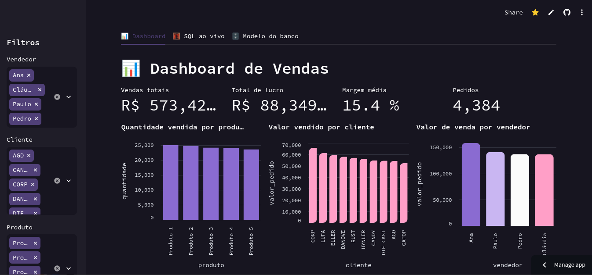

# Dashboard de Vendas com SQLite e Streamlit

Projeto de banco de dados que transforma uma planilha de vendas em um modelo relacional, com carga automatizada em Python, consultas SQL avançadas e um dashboard interativo publicado na web.

**App online:** https://projetothaiveira.streamlit.app/



## O que o projeto faz

- Modela os dados de 4.384 pedidos (2021) em um banco relacional normalizado.
- Carrega a planilha Excel no banco com um script ETL.
- Responde perguntas de negócio com consultas SQL (JOIN, CTE, subquery e window functions).
- Exibe indicadores e gráficos em um dashboard com filtros por vendedor, cliente, produto, região e período.
- Permite executar consultas SQL ao vivo, com conexão somente leitura.
- Documenta o modelo dentro do próprio app, com diagrama entidade-relacionamento e script de criação.

## Interface

- **Três abas:** Dashboard, SQL ao vivo e Modelo do banco.
- **Dashboard:** quatro indicadores (vendas totais, lucro, margem média e pedidos) e seis gráficos: quantidade e valor por produto, valor por cliente, valor por vendedor e valor por região (barras), e vendas mensais (linha).
- **Filtros na barra lateral:** vendedor, cliente, produto, região e período. Todos os indicadores e gráficos respondem a eles.

## Tecnologias

Python · SQLite · pandas · openpyxl · Altair · Streamlit

## Estrutura

```
.
├── app.py                     # dashboard Streamlit
├── requirements.txt
├── .streamlit/
│   └── config.toml            # tema do app
├── data/
│   └── system_extraction.xlsx # planilha de origem (aba salesreport)
├── sql/
│   ├── schema.sql             # tabelas, índices e view
│   └── queries.sql            # consultas exibidas na aba "SQL ao vivo"
├── src/
│   └── etl.py                 # lê o Excel e cria db/vendas.db
└── docs/
    └── dashboard.png          # print do app
```

O banco `db/vendas.db` é gerado pelo ETL e não é versionado.

## Modelo de dados

```
vendedor ──┐
cliente  ──┼──< pedido
produto  ──┤
região   ──┘
```

| Tabela | Descrição |
|---|---|
| `pedido` | Tabela de fatos: número do pedido, data, quantidade, preço e margem de lucro |
| `vendedor`, `cliente`, `produto`, `regiao` | Tabelas de dimensão, cada uma com `id` e `nome` únicos |
| `vw_vendas` | View que junta tudo e calcula `valor_pedido` (quantidade × preço) |

### Decisões de modelagem

- **Normalização:** dados que se repetem (nome de cliente, produto etc.) ficam em tabelas próprias, ligadas ao pedido por chave estrangeira.
- **Valor derivado em view:** `valor_pedido` pode ser calculado, então não é gravado e evita inconsistência.
- **Restrições:** `CHECK` impede quantidade e preço menores ou iguais a zero, e `UNIQUE` evita nomes duplicados nas dimensões.
- **Índices:** criados na data e nas chaves estrangeiras, que são as colunas mais usadas em filtros.
- **Datas em formato ISO** (`AAAA-MM-DD`), o que permite ordenar e usar `strftime`.

## Consultas SQL

O arquivo `sql/queries.sql` traz cinco consultas, também disponíveis na aba **SQL ao vivo** do app:

| Consulta | Técnica |
|---|---|
| Faturamento e margem por vendedor | `GROUP BY` |
| Ranking de produtos por região | window function `RANK()` |
| Evolução mensal com acumulado | CTE e `SUM() OVER` |
| Clientes acima do ticket médio | subquery com `HAVING` |
| Melhor vendedor de cada mês | CTE e `ROW_NUMBER()` |

## Requisitos

Python 3.10 ou superior.

## Publicação

O app está hospedado no Streamlit Community Cloud, a partir do repositório no GitHub. A planilha em `data/` e o tema em `.streamlit/` fazem parte do repositório, e o banco é gerado automaticamente no primeiro acesso. https://projetothaiveira.streamlit.app/


**Thaise Oliveira** [Site](https://thaiveira.com.br) · [LinkedIn](https://linkedin.com/in/thaiveira)
